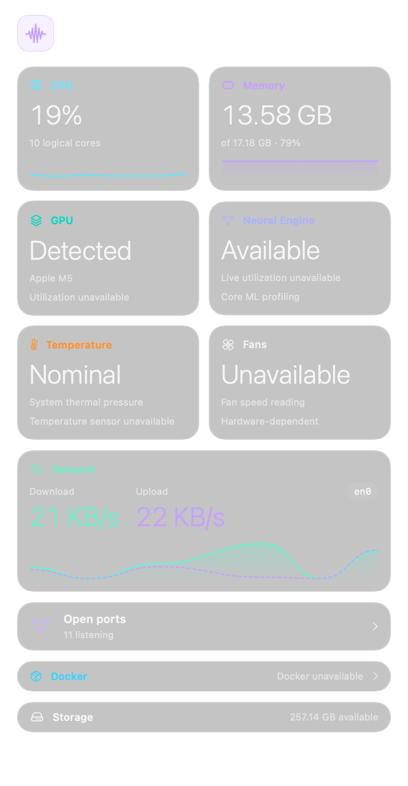

# GlassStats

**Keep your Mac’s vitals, local ports, and Docker containers in view while you work.**

GlassStats is a native macOS monitor with a transparent desktop dashboard and configurable menu-bar readouts. Glance at CPU, memory, and network activity, see what owns a busy development port, or check which containers are running without switching to a full-size monitoring window.

[Install](#install-glassstats) · [Build from source](#build-from-source) · [Controls](#make-it-yours) · [Troubleshooting](#troubleshooting) · [Contribute](#contribute)

**macOS 14+ target** · **Apple Silicon and Intel builds** · **SwiftUI and AppKit** · **MIT license**

⭐ **If GlassStats earns a spot on your desktop, click Star at the top of this GitHub repository.**

<p align="center">
  <picture>
    <source media="(prefers-color-scheme: dark)" srcset="docs/dashboard-dark.png">
    <source media="(prefers-color-scheme: light)" srcset="docs/dashboard-light.png">
    
  </picture>
</p>

<table>
<tr>
<td><strong>Watch your Mac</strong><br>See CPU, memory, network, storage, and thermal pressure in a panel you can leave beside your editor.</td>
<td><strong>Find the process behind a port</strong><br>Look up a local TCP listener or UDP socket by port, process name, or PID. Review the owner before requesting a graceful stop.</td>
<td><strong>Check Docker at a glance</strong><br>See container names, images, status, and published ports from the local Docker Engine.</td>
</tr>
</table>

## Install GlassStats

**If you have `GlassStats.zip`**

1. Quit any running copy using **right-click GlassStats in the menu bar → Quit GlassStats**.
2. Extract `GlassStats.zip` and move `GlassStats.app` to **Applications**. Keep the app bundle intact.
3. Open that copy. Click the GlassStats menu-bar readout or press **⌃⌥⌘G** to show the dashboard.

If this repository has a release with a `GlassStats.zip` attachment, use that archive. You can also [build an archive locally](#build-from-source). If a checksum was supplied, put both files in the same folder and run the command below from that folder.

```sh
shasum -a 256 -c GlassStats.zip.sha256
```

The local build and CI archives use ad-hoc signing. macOS may show a first-launch security prompt for a downloaded archive. For a copy you trust, follow Apple’s per-app instructions. Developer ID signing and notarization for public distribution are covered in the [release guide](docs/RELEASING.md). [Apple’s first-launch guidance](https://support.apple.com/en-us/102445)

## Build from source

Building requires a Mac with **Swift 6** and the **macOS 26 SDK or later**. Use Xcode or compatible Command Line Tools. GlassStats uses Apple system frameworks and libraries, so the project has no third-party package dependencies.

### 1. Get the source

On GitHub, open **Code** and copy the HTTPS URL. Replace `<repository-url>` with the URL you copied.

```sh
git clone "<repository-url>" glass-stats
cd glass-stats
```

If you already have the project, open Terminal in the folder containing `Package.swift`. You can also choose **Code → Download ZIP**, extract it, and open the extracted folder in Terminal.

### 2. Verify your Apple toolchain

Install the Command Line Tools if you need them, then check which toolchain is active. [Apple’s Command Line Tools installation guide](https://developer.apple.com/documentation/xcode/installing-the-command-line-tools)

```sh
xcode-select --install
```

```sh
xcode-select -p
swift --version
xcrun --show-sdk-version
```

The SDK major version should be at least `26`. If you have a compatible Command Line Tools installation and a different Xcode is active, select the Command Line Tools for this terminal session. If you use full Xcode, open it once to complete any first-launch setup. [Apple’s toolchain selection guide](https://developer.apple.com/documentation/xcode/configuring-command-line-tools-settings)

```sh
export DEVELOPER_DIR=/Library/Developer/CommandLineTools
```

### 3. Test, package, and launch

Run these commands from the project root. Quit any running GlassStats copy before opening the new build.

```sh
Scripts/test.sh
Scripts/package.sh
open dist/GlassStats.app
```

| Output | Purpose |
| --- | --- |
| `dist/GlassStats.app` | Run the app directly or move the bundle to Applications. |
| `dist/GlassStats.zip` | Archive containing the app bundle and embedded widget extension. |
| `dist/GlassStats.zip.sha256` | Verify the ZIP against the packaged checksum. |

The default archive matches the architecture of your Mac. To package both Apple Silicon and Intel in one app or build a debug copy, use the corresponding command below. Both commands write to `dist/`.

```sh
ARCHS="arm64 x86_64" Scripts/package.sh
CONFIGURATION=debug Scripts/package.sh
```

### 4. Verify the app and archive

```sh
codesign --verify --deep --strict dist/GlassStats.app
(cd dist && shasum -a 256 -c GlassStats.zip.sha256)
plutil -extract CFBundleShortVersionString raw dist/GlassStats.app/Contents/Info.plist
```

For a GUI smoke test, quit the interactive app and run the command below. The test opens the dashboard and inspectors, checks live sampling, reports resource usage, then exits.

```sh
dist/GlassStats.app/Contents/MacOS/GlassStats --smoke-test 60 --measure-low-power
```

## Make it yours

| What you want | Where to find it |
| --- | --- |
| Show or hide the dashboard | **⌃⌥⌘G** or click the menu-bar readout. |
| Pick cards and charts | Click the **sliders** button in the dashboard header. |
| Choose dashboard shortcuts | **Settings → Appearance → Dashboard shortcuts**. |
| Change menu-bar metrics | **Settings → General → Menu bar**. Add, remove, or reorder metrics and pick a readout style. |
| Keep the dashboard above windows | **Settings → General → Float above other windows**. Use **Show across Spaces and full-screen apps** to keep it visible on other Spaces. |
| Save its position | Drag the dashboard where you want it. It remembers its last frame on relaunch. Version 0.2.0 allows dragging and system repositioning after display changes. |
| Choose clear or frosted glass | **Settings → Appearance → Frosted glass**. Clear glass is the default. Frosted glass uses Liquid Glass on macOS 26 and later and a native material on macOS 14–15. |
| Reduce sampling work | **Settings → Monitoring → Low Power**. It slows live sampling and hides dashboard sparklines. Use **Modules** to turn collectors off. |
| Launch automatically | **Settings → General → Launch at login**. Enable **Show dashboard on launch** if you want the panel to open too. |

Right-click the GlassStats menu-bar readout for **Settings**, **Open Ports**, **Docker**, **Processes**, and **Sensors**. When the dashboard is open, its sliders menu also contains **Settings…**.

## Inspect a local port or container

### Ports

Open **Ports**, choose **TCP listeners** or **UDP sockets**, and filter by port, process name, PID, or bind scope. Select a row to copy its details or inspect the process.

Use **Close Selected Port…** for one row. **Close All Ports…** offers a stop request for the filtered rows or for all eligible TCP listeners and unconnected UDP sockets. Both actions preview eligible local development processes you own. After confirmation, the app rechecks their identities and sends a graceful stop request. Other ports owned by those processes may close too.

A non-loopback bind shows where a socket is listening locally. Firewall and routing determine internet reachability.

### Docker

Start Docker Desktop or a compatible local engine that exposes the Docker Desktop Unix socket or `/var/run/docker.sock`. Open **Docker** from the menu bar or dashboard card. The list refreshes every five seconds while visible and less frequently in Low Power mode or when the engine is unavailable. Use **Refresh** after starting the engine. GlassStats reads container names, images, runtime state, and published ports. [Docker Engine container listing](https://docs.docker.com/reference/api/engine/version/v1.57/operations/ContainerList/)

### Desktop widgets

Live WidgetKit snapshots require a [signed App Group build](docs/RELEASING.md). Install that build, launch GlassStats, then right-click the desktop, choose **Edit Widgets**, and search for **GlassStats**. The widgets show timestamped snapshots on WidgetKit’s schedule. The dashboard displays live charts. [Apple’s WidgetKit refresh guidance](https://developer.apple.com/documentation/widgetkit/keeping-a-widget-up-to-date/)

## Measurements and compatibility

| Module | Coverage |
| --- | --- |
| CPU and memory | CPU usage per logical core, load averages, memory use, available-memory estimate, compression, swap, and macOS memory pressure events. |
| Network and storage | Transfer rates and session totals for the primary interface, plus capacity and free space on the volume containing your home directory. |
| Processes | Searchable, sortable CPU and physical memory readings while the inspector is visible. |
| Hardware | Metal device information, Core ML Neural Engine availability, and macOS thermal pressure. Temperature, fan RPM, and system-wide GPU and Neural Engine utilization are unavailable in the current build. |

GlassStats schedules readings around the features in use. Hiding the dashboard releases its rendering view, and unused network, port, and Docker collectors stop in the default menu-bar-only setup.

| 0.2.0 mode | Average CPU, as a share of one core |
| --- | ---: |
| Menu bar only | 0.23% |
| Low Power dashboard | 0.96% |
| Standard dashboard | 4.26% |

These are process measurements from one Apple Silicon Mac on macOS 26.6. The observation time and workload vary by mode. The Universal archive contains Intel and Apple Silicon builds. Runtime verification on Intel and older macOS versions is pending. [Test results and measurement durations](docs/VERIFICATION.md)

## Troubleshooting

| Symptom | What to check |
| --- | --- |
| The old UI appears after an update | Quit GlassStats from its menu-bar menu and open the exact new `GlassStats.app`. A running copy can keep showing its old UI after the bundle is replaced. |
| The dashboard is missing | Press **⌃⌥⌘G**. If the menu-bar readout is visible, you can also click it or choose **Toggle Dashboard** from its right-click menu. |
| A card or graph is missing | Check the sliders menu and **Settings → Monitoring → Modules**. CPU and memory sparklines are hidden in compact mode. Low Power hides dashboard sparklines. |
| Docker Engine unavailable | Start the local engine, confirm it exposes a supported local socket, then click **Refresh** in the Docker pane. |
| Port closing skips a process | The action is scoped to eligible local development processes owned by your account. Protected apps, system executables, and the Docker backend are excluded. |
| Build fails with missing tools or SDK | Check `xcode-select -p`, `swift --version`, and `xcrun --show-sdk-version`. Select a toolchain with the macOS 26 SDK or later and rerun the build. |

## Privacy

GlassStats runs under your macOS account without a privileged helper. It has no accounts, analytics, or remote telemetry. Docker queries stay on a local Unix socket. Optional SQLite chart history is off by default. Manage history and widget sharing in **Settings → Privacy**.

## Contribute

A bug report with your macOS version, Mac architecture, GlassStats version, and reproduction steps is a useful contribution. Feature ideas and fixes are welcome too. To work on a change, fork the repository, build and test locally, then open a pull request. [Contributing guide](CONTRIBUTING.md) · [Code of Conduct](CODE_OF_CONDUCT.md) · [Private security reporting](SECURITY.md)

[Architecture](docs/ARCHITECTURE.md) · [Release signing and packaging](docs/RELEASING.md) · [Changelog](CHANGELOG.md) · [MIT License](LICENSE)
